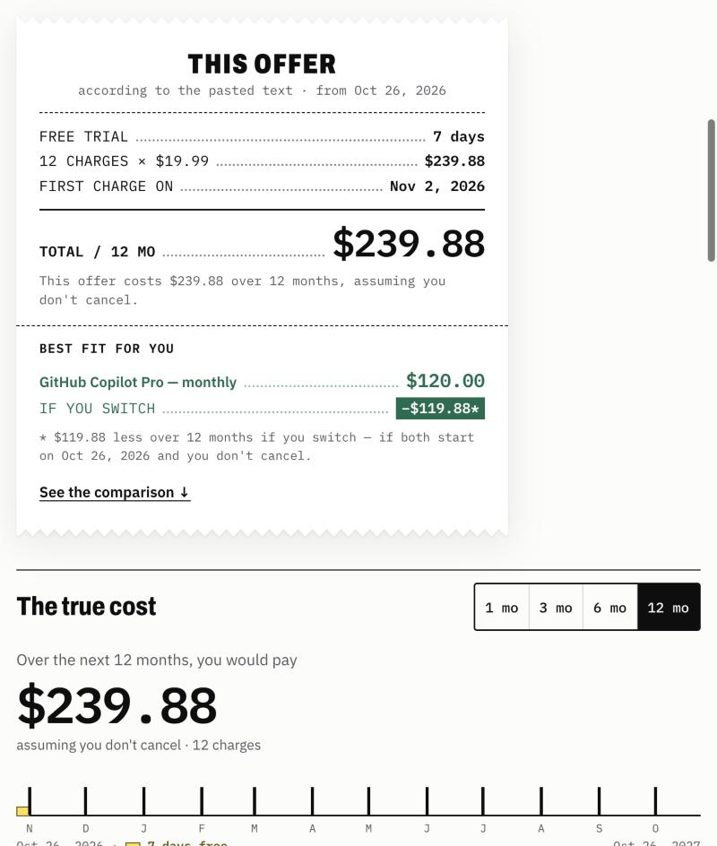
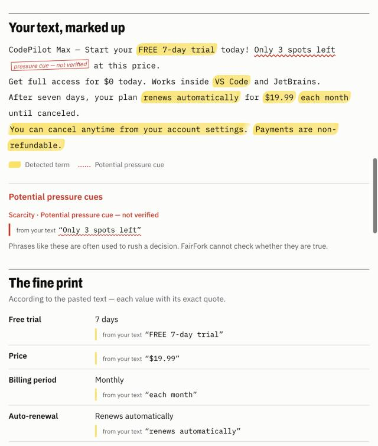
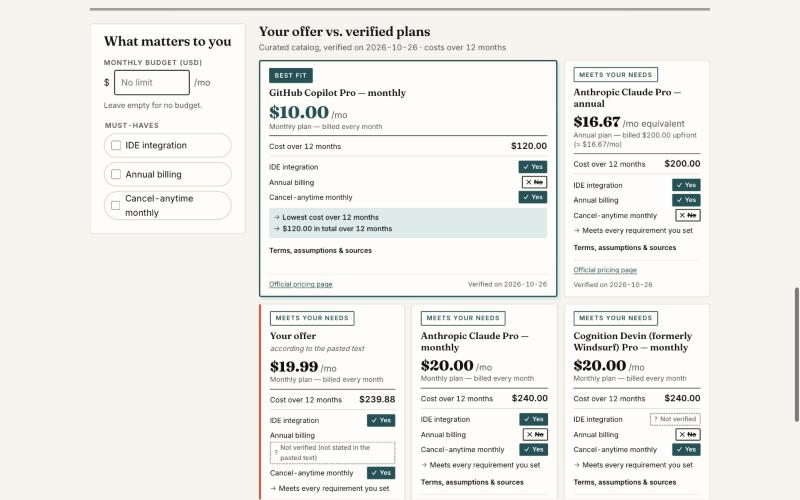

# FairFork

**Know the true cost. Find a better choice.**

Paste a subscription offer. FairFork highlights the fine print in your own text, works out what it will really cost over 1, 3, 6 or 12 months, and compares it with real AI coding-assistant plans whose prices and terms were checked on official pages — then tells you which one fits *your* requirements, and why.

Built for the Devpost **Build With AI: Basics** hackathon (October 2026).

- **Live demo:** https://silentarcherjr.github.io/fairfork/
- **License:** [MIT](LICENSE)

| The receipt: what the offer really costs | Your text, marked up | Pick what matters, see the best fit |
|---|---|---|
|  |  |  |

## What it does

1. **Cited fine print — in English or Spanish.** Trial length, price, billing period, auto-renewal, cancellation and refund terms are extracted from the pasted text. Every value is highlighted where it appears; anything missing says *"Not found in the text"* — never a guess, never $0.
2. **Pressure cues, labeled honestly.** Phrases like "Only 3 spots left" are flagged as *potential pressure cues — not verified*, not as lies.
3. **True cost timeline.** Charge dates and totals from a start date you choose, with every assumption written out ("assuming you don't cancel").
4. **Verified alternatives.** A small, curated catalog — GitHub Copilot Pro and Pro+, Claude Pro (monthly and annual) and Max 5x, Devin (formerly Windsurf) Pro and Max — where each price, term and feature links to the official page and a verbatim quote, verified on 2026-10-26. See [`docs/sources.md`](docs/sources.md).
5. **Screenshot import (beta).** Don't want to copy text? Import a screenshot of the offer: the text is read in your browser (OCR with tesseract.js) and placed in the box for you to check before analyzing — OCR can misread, so nothing is analyzed automatically.
6. **What nobody told you.** One ledger lists every fact that isn't stated in your offer or couldn't be verified for a plan — unknown is not the same as "no".
7. **Ask before you pay.** Every unknown comes with a concrete question to send the provider.
8. **Try real terms.** Analyze a text made only of verbatim quotes from a plan's official pages — not a made-up example.
9. **Copy receipt.** Copy a plain-text receipt (cost, assumptions, best fit, sources) to share before you decide.
10. **Explained choice.** Set a monthly budget and must-haves (IDE integration, annual billing, cancel-anytime monthly). Options are sorted into **Best fit**, **Can't confirm** (a requirement we could not verify — *not verified* is not the same as *doesn't have it*) and **Doesn't meet your needs**, each with a written reason.

Nothing you paste is stored or sent anywhere: the app runs entirely in your browser, with no login, no server and no API keys. The only network request is optional: the first time you use the screenshot import, the OCR engine and its English model (~10–15 MB) are downloaded from the jsDelivr CDN — your image itself never leaves the browser.

## Run it locally

Requires Node.js 20+.

```bash
npm install
npm run dev
```

Open http://localhost:5173/fairfork/ and click **Analyze offer** on the pre-filled fictional example (or **Try another example**, or paste your own).

Other commands:

```bash
npm test          # 226 unit, adversarial and UI tests (Vitest)
npm run build     # type-check + production build into dist/
npm run preview   # serve the production build
```

The GitHub Actions workflow in `.github/workflows/deploy.yml` runs the tests, builds, and publishes to GitHub Pages on every push to `main`.

## How it works

| Piece | File | What it does |
|---|---|---|
| Offer reader | `src/lib/parseOffer.ts` | Rules-based extraction; every value keeps its exact quote and position |
| Cost calculator | `src/lib/billing.ts`, `src/lib/dates.ts` | Charge dates (month-end safe, UTC) and totals in integer cents |
| Verified catalog | `src/data/alternatives.ts` | Curated plans with official URL + verbatim quote per fact |
| Ranker | `src/lib/ranking.ts` | Budget and must-haves → Best fit / Can't confirm / Doesn't meet, with reasons |
| Screenshot import (beta) | `src/lib/ocr.ts`, `src/components/ImageImport.tsx` | Lazy-loaded in-browser OCR that only fills the text box for review |
| Interface | `src/components/*`, `src/App.tsx` | Editorial single page; user text is always rendered as plain text |

## Limitations (honest list)

- **English and Spanish offers with common phrasing only.** The reader uses rules, not AI; unusual wording comes back as "Not found".
- **Screenshot import is beta.** OCR can misread characters (e.g. "AI" → "Al"); always check the text before analyzing. Needs an internet connection the first time.
- **Introductory prices** ("first month $1, then $20/month") are not modeled — the regular price is used.
- **The catalog is curated, not live.** Prices were verified on 2026-10-26 and can change; they may vary by country and exclude taxes. Only USD prices are compared; other currencies are shown as "not comparable".
- Catalog plans are assumed to charge from the start date (no trial counted unless verified).
- FairFork shows evidence and tradeoffs. It is **not** financial or legal advice.

## How this was built

The project was planned and built with the **[Devpost Learn Skill Pack](https://github.com/challengepost/learn-ai-basics)** (skills `1-start` → `6-ship`) in Claude Code. The approved planning documents are in [`devpost/`](devpost/): [`scope.md`](devpost/scope.md), [`prd.md`](devpost/prd.md), [`spec.md`](devpost/spec.md) and the build [`checklist.md`](devpost/checklist.md). Implementation was split across parallel AI subagents (parser/billing, verified catalog/ranking, UI, adversarial QA) against frozen TypeScript contracts, then integrated and verified slice by slice. QA results: [`docs/qa.md`](docs/qa.md).

The example offers in the app are fictional. Provider names belong to their owners and are used only to cite their public pricing pages.

## Credits, third-party code and disclosure

- Built from scratch during the hackathon submission period (first commit 26 Oct 2026); no code from earlier projects.
- Libraries: [React](https://react.dev) (MIT), [tesseract.js](https://github.com/naptha/tesseract.js) (Apache-2.0, loaded only for the screenshot import, with its English model fetched from the jsDelivr CDN), built with Vite, TypeScript and Vitest (MIT).
- Fonts: [Archivo](https://fonts.google.com/specimen/Archivo), [IBM Plex Sans and Plex Mono](https://fonts.google.com/specimen/IBM+Plex+Sans) via Google Fonts (SIL Open Font License).
- Planning workflow: the [Devpost Learn Skill Pack](https://github.com/challengepost/learn-ai-basics) (MIT), included under `.claude/skills/` with its license.
- Provider prices and terms are short verbatim quotes from each provider's public pages, cited with links in [`docs/sources.md`](docs/sources.md). Product names belong to their owners; FairFork is not affiliated with any provider.
